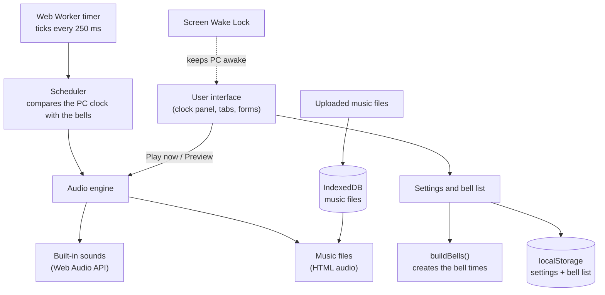

# Smart Bell System

**Kuli/ Sri Dhammandha Maha Vidyalaya, Udubaddawa**

A simple school bell scheduler that runs in a web browser. Set the time the school day starts, the length of each period and the gap between periods, and the system creates every bell time automatically and rings them on schedule. Bells can also be played by hand, and every bell can use its own sound or music.

Created by A. Thivaharan. Developed with the assistance of AI.

---

## Features

- **Automatic bell times.** Enter the day start time, period length, break length and number of periods. One button creates the full list of bells.
- **Constant interval control.** Change the gap between periods at any time and rebuild the schedule.
- **Optional long break** after a chosen period (for example, an interval after period 3).
- **Manual play.** Play any bell or music file on demand, with a Stop button (Esc also works).
- **Sound for every bell.** Each bell has its own sound. One click applies a sound to all bells.
- **Own music.** Upload mp3, wav, m4a or ogg files. Uploaded music always plays to the end.
- **Edit any bell.** Change a time or name, switch a bell off, add extra bells or delete bells.
- **School days.** Choose which days of the week the bells ring.
- **Keeps the PC awake** while the bells are turned on (see [Keeping the PC awake](#keeping-the-pc-awake)).
- **Light, large, plain interface** with three tabs: Play now, Bell times, Music.

---

## Architecture

### Everything is in one file

The whole application is a single file: [`smart-bell-system.html`](smart-bell-system.html).

The HTML (structure), CSS (styling) and JavaScript (logic) are all included in that one file. This is deliberate. It makes the application easy to move to the school computer: copy one file, open it in a browser, and it works. There is nothing to install, no build step, no server, no database and no internet account.

```
smart-bell-system.html
├── <style>   all CSS, written with colour and font variables
├── <div>     all HTML: clock panel, three tabs, forms, bell list
└── <script>  all JavaScript: scheduler, audio, storage, user interface
```

The only thing loaded from outside the file is the font (Barlow, Barlow Condensed and IBM Plex Mono from Google Fonts). If the computer is offline, the browser falls back to Arial and the system sans-serif font, and everything else still works.

### How the parts fit together



### Modules inside the script

| Part | What it does |
| --- | --- |
| `buildBells(cfg)` | A pure function. Takes the start time, period length, gap, number of periods and long-break settings, and returns the list of bell times and names. It has no dependency on the page, so it is easy to test on its own. |
| Scheduler (`checkBells`, `nextBell`) | Runs four times a second. Rings a bell when the PC clock reaches its time, once per day per bell. A bell is allowed to ring up to 90 seconds late, so a brief browser stall does not skip it. Also works out the next bell for the countdown. |
| Timer (Web Worker) | The tick comes from a small Web Worker created inside the file. Workers are not slowed down as much as ordinary page timers when the window is in the background. If a worker cannot be created, the page falls back to `setInterval`. |
| Audio engine (`play`, `stopAll`) | Plays one sound at a time. A new sound replaces the one that is playing. Built-in sounds are generated by the Web Audio API. Uploaded music is played through an HTML audio element. Volume is applied to both. |
| Built-in sounds | Classic school bell, ding-dong chime, rising chime and digital beeps. These are generated in code, so no audio files are bundled. |
| Storage | Settings and the bell list are saved in `localStorage` (key `smartbell.v1`). Uploaded music files are saved in IndexedDB (database `smartbell`, store `sounds`). |
| Wake Lock | Asks the browser to keep the screen on while bells are turned on, and asks again when the page becomes visible. |
| User interface | Plain DOM code that draws the clock panel, the tabs, the bell list and the music list from the current settings. |

### Data model

Settings (saved in `localStorage`):

```
start        day start time, "HH:MM"
periodMin    length of each period in minutes
gapMin       break between periods in minutes
periods      number of periods
longAfter    period after which a long break happens (0 = none)
longMin      long break length in minutes
ringEnd      also ring when each period ends
defaultSound sound given to newly created bells
days         school days, 0 = Sunday ... 6 = Saturday
volume       0 to 1
manualSound  last sound chosen in the Play now tab
```

Each bell:

```
id      unique id
time    "HH:MM"
label   name shown in the list
sound   "b:<name>" for a built-in sound, "u:<id>" for an uploaded file
on      true or false
```

### How the bell times are created

1. The first bell is "Period 1 begins" at the day start time.
2. Each period lasts `periodMin` minutes.
3. If "ring at the end of every period" is ticked, a bell rings when each period ends.
4. The gap before the next period is `gapMin` minutes, or `longMin` after the long-break period.
5. The next period begins and the cycle repeats.
6. After the last period, a "School day ends" bell is added.

Example: start 07:30, 40-minute periods, 5-minute gaps, 8 periods, long break of 20 minutes after period 3 gives bells from 07:30 to 13:40.

---

## Requirements

- A computer with a current version of **Google Chrome** or **Microsoft Edge** (recommended). Firefox and Safari also work for most features.
- Speakers connected to the school bell or sound system.
- No internet is needed after the file is on the computer (only the fonts are loaded online, and they have fallbacks).

---

## How to install on the school computer

1. Copy `smart-bell-system.html` to the school computer (USB drive, email or download from GitHub).
2. Put it in a permanent folder, for example `C:\SchoolBell\`.
3. Double-click the file to open it in Chrome or Edge.
4. Optional: create a shortcut to the file and place it in the Windows Startup folder so it opens when the computer starts.

You can also host it on **GitHub Pages** and open the web address on the school computer. Hosting is optional. The file works the same either way.

---

## How to use

1. Open the **Bell times** tab. Enter the day start time, each period, the break and the number of periods. Press **Make bell times**.
2. Open the **Music** tab to add your own music files if you want them.
3. In the bell list, choose the sound for each bell.
4. Press **Turn bells on** at the top. The page shows **Bells are ON**.
5. Leave the page open. Bells ring at the listed times on the chosen school days.
6. Use the **Play now** tab to ring a bell or play music by hand at any time.

Before the first real school day, add a test bell a minute or two ahead, turn the bells on and check that it rings.

---

## Keeping the PC awake

The page asks the browser to keep the screen awake while the bells are on, and shows a message saying whether this worked. Browsers only allow this in a secure context and while the page is visible, so also set the computer itself not to sleep:

- Windows: **Settings, System, Power, Screen and sleep**, then set **Sleep** to **Never**.
- Keep the bell page open in its own browser window and do not minimise-and-close it.

---

## Good to know

- **The page must stay open.** Bells only ring while the page is open in the browser with the bells turned on.
- **Turn bells on once after opening.** Browsers only allow sound after a click, so the button must be pressed each time the page is opened.
- **Same browser every time.** Settings and music are stored inside the browser. Opening the file in a different browser, or from a different location, starts with empty settings.
- **Clearing browser data removes settings and music.** Do not clear site data for this page.
- **The PC clock decides the time.** Keep the computer's date and time correct.
- **One sound at a time.** If a new bell arrives while a sound is still playing, the new sound replaces it.
- **Built-in bells are short.** The classic bell and digital beeps play for about 8 seconds. Uploaded music plays to the end.

---

## Project files

| File | Purpose |
| --- | --- |
| `smart-bell-system.html` | The complete application (HTML, CSS and JavaScript in one file) |
| `README.md` | This document |

---

## Credits

Created by A. Thivaharan. Developed with the assistance of AI.
